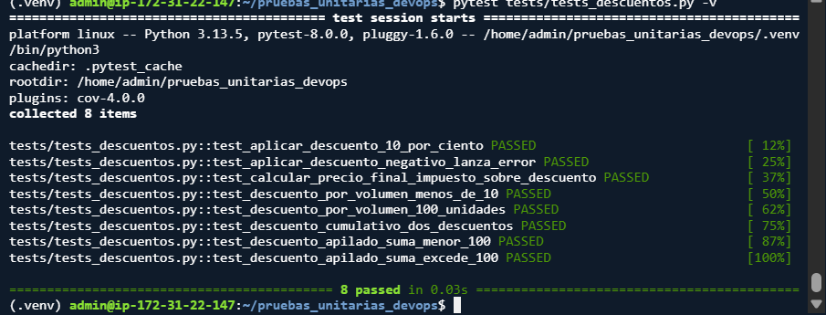
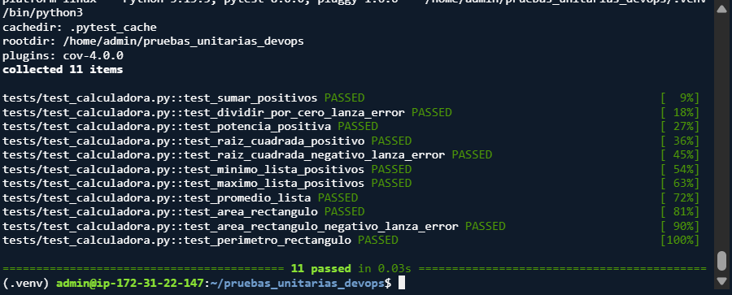
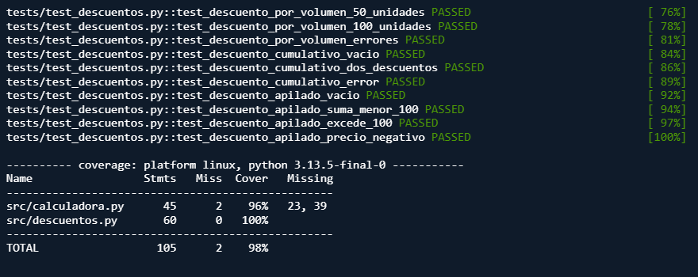

# Informe — Análisis y Mejora de Pruebas Unitarias

**Nombre:** Camilo Londoño Garcia
**Fecha:** 17 de octubre de 2026
**Repositorio:** https://github.com/clondonoga/pruebas_unitarias_devops

---

## 1. Análisis por módulo (Criterio de las pruebas)

**`calculadora.py`**
El criterio principal fue dejar de probar solo los casos "felices" (como sumar 2+2) y enfocarme en los bordes que suelen romper el código en producción. Probé con ceros, negativos y listas vacías. La idea era verificar que el código no solo devolviera números, sino que lanzara los `ValueError` correspondientes cuando la operación matemática no tiene sentido (por ejemplo, la raíz de un negativo o una lista vacía). Logré un total de 11 pruebas exitosas en este módulo.

**`descuentos.py`**
Al ser un módulo financiero, aquí el criterio fue la precisión y el orden de las operaciones. Me enfoqué en validar los límites lógicos (descuentos del 0%, 100% y fuera de rango) y, sobre todo, el orden de aplicación del impuesto. Probé los saltos del descuento por volumen en las cantidades exactas (10, 20, 50 y 100) y el escenario donde la suma de descuentos apilados supera el 100%, asegurando que el sistema no colapse y sepa topar el límite. Aquí implementé 8 pruebas exitosas.

---

## 2. Evidencias de ejecución

**A. Pruebas en verde (Calculadora):**
Captura de las 11 pruebas pasando correctamente.

**B. Pruebas en verde (Descuentos):**
Captura de las 8 pruebas pasando correctamente.

**C. Reporte de Cobertura:**
Salida del comando `pytest --cov`, donde se destaca el 96% en calculadora, 100% en descuentos y un total del 98% de cobertura.

---

## 3. Tabla de Bugs Encontrados y Corregidos

| Módulo | Función | Entrada | Resultado erróneo | Esperado | Corrección aplicada |
|--------|---------|---------|-------------------|----------|---------------------|
| calculadora | `raiz_cuadrada` | `-4` | `2j` (complejo) | `ValueError` | Validar si `numero < 0` y lanzar excepción. |
| calculadora | `minimo` | `[5, 8, 3]` | `0` | `3` | Cambiar `min_val = 0` por `min_val = lista[0]`. |
| descuentos | `calcular_precio_final` | `100, 19, 10` | `109.0` | `107.1` | Calcular el impuesto sobre el `precio_con_descuento`. |
| descuentos | `descuento_apilado` | `[60, 50]` | `ValueError` | `0` | Usar `min(total_descuento, 100)` para topar el límite. |

---

## 4. Reflexión final

La conclusión más grande que me deja este taller es que **la cobertura no lo es todo**. Puedes tener un 100% de cobertura con pruebas que no verifican nada útil. 

Lo valioso fue ponerme en los zapatos del "detective": buscar qué entrada rompe el código. Me di cuenta de que los bugs más peligrosos no son los que explotan y lanzan un error (esos son fáciles de ver), sino los que se ejecutan silenciosamente y te dan un resultado mal (como cobrar mal un impuesto o decirte que el mínimo de una lista es 0). El estándar AAA (Arrange, Act, Assert) me ayudó a estructurar las pruebas para que sean fáciles de leer y demuestren el criterio técnico detrás de cada caso.
